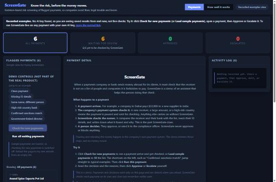

# ScreenGate

**A faster first pass on flagged cross-border payments, with the evidence written down and a person making every decision.**

An AML sanctions-screening copilot prototype for cross-border B2B payments on the UAE-India and UAE-UK corridors. A Screening Agent recommends Pass, Enhanced Due Diligence, or Escalate with cited reasoning, and a compliance analyst makes the final decision.

**[Try it, no key needed](https://shreebyravi.github.io/screengate/recorded-examples/)** | **[One-page summary](docs/PITCH.md)** | **Status:** prototype with synthetic data

**Created by Shree Byravi.** Product design, evaluation, and the launch plan are Shree Byravi's work. The prototype was built with an AI coding assistant, working from those decisions.

## What this is

A prototype designed to be used under human review. All data is synthetic: fabricated names, watchlist entries, and transactions. No real people, companies, or sanctions records are included.

## Product case study

**The problem.** A company that sends money abroad must not pay a sanctioned party. The cost of getting it wrong is fines, legal trouble and losses. In practice the company's payment system flags some payments, and an analyst checks the receiver by hand: slow, and uneven when the team is busy.

**Who it is for.** Compliance analysts at a payments company, and the compliance officer who takes the escalations. The full breakdown of user segments, what each needs and worries about, and what is still an assumption is in [docs/DISCOVERY.md](docs/DISCOVERY.md).

**What ScreenGate does.** For each flagged payment it checks the receiver and the receiver's bank against the sanctions list, country risk and policy, then recommends Looks clear, Extra checks needed, or Cannot clear: escalate, with cited evidence. A person decides.

**Decisions I made**
- A person always decides. ScreenGate recommends and never approves or blocks anything.
- Only payments the payment system flags reach ScreenGate, so analyst time goes where the risk is.
- It screens sanctions, watchlist and policy risk. It does not claim to detect fraud.
- All data is synthetic, so a real pilot waits for a privacy and legal review.

**How I tested it.** Six test payments, each with the expected result written in advance, run through the agent and judged by me. All six passed.

**What I changed after testing.** On a deliberately hard case (T-1016) ScreenGate escalated correctly, but its citation named an alias that was not in the payment data. I tightened the instructions so it cites only the field that matched, and re-tested.

**Launch plan.** See the [full plan](docs/LAUNCH_PLAN.md), with requirements, owners and post-launch metrics. Conditional go: a 6-week pilot with 2 compliance analysts and about 180 flagged payments, running alongside the current process with every recommendation reviewed. Success bars: at least 80% of recommendations accepted and zero missed escalations. Named owners, a written rollback, and a formal privacy and legal review first.

**Stress tests.** Six harder cases, including a trick instruction and a fake clearance claim, each ran three times. All escalated as expected, but one exposed a loose policy rule. See [the results](docs/EVALS.md).

**Known limits.** Name matching relies on the AI's own judgment and was tested on only a small set of cases. English names only. Decisions are not saved after a page reload.

**What is next.** Customer-set payment ceilings by risk level, a second approver for very large payments, a sortable and filterable queue, and in-product feedback.

## Product documentation

See the [documents map](docs/README.md) for the PRD, discovery, market scan, design, architecture, agent instructions, data guide, decisions, evals, risks, launch plan and roadmap.

[AI product decisions](docs/AI_PRODUCT_DECISIONS.md) covers how AI changes product work, the choices and trade-offs made here, what a real implementation would add, and my role. A short version is in the app's **How well it works** tab.

| Path | Contents |
|---|---|
| `index.html` | The whole app, in one file |
| `recorded-examples/` | A link that always opens the recorded view |
| [`docs/`](docs/README.md) | Product documents |
| `data/` | Synthetic payments, profiles, watchlist and test cases |
| `policies/` | Fictional escalation policy and audit template |
| `design/` | Notes on the look and feel |

## Product FAQ

**Why AI and not simple matching rules?** Rules are good at finding a possible match. They are weak at the judgment that follows: is this the same person or just the same name? ScreenGate adds that judgment and writes down its reasons, using the fields that actually matched (date of birth, nationality, ID). A person still decides.

**How is this different from existing screening tools?** Traditional screening raises the alert, and ScreenGate sits after it. This isn't a new idea, though: vendors already describe AI for reviewing sanctions alerts, as the [market scan](docs/MARKET_SCAN.md) sets out. ScreenGate is a portfolio prototype showing how to scope, test and safely pilot this step. It does not replace the screening tool or the payment system.

**Who is the user?** The compliance analyst who reviews flagged payments, and the compliance officer who takes the escalations.

**Why only UAE-India and UAE-UK payments?** A narrow scope keeps the pilot small and testable. Those two corridors are also where the sample cases come from.

**Why does a person always decide?** The company stays accountable for every payment. ScreenGate recommends and explains; it never approves or blocks, and a confirmed watchlist match is always escalated.

**What are the biggest risks?** A missed escalation (the one that matters most), analysts over-trusting the recommendation, and personal data going to an AI provider. The plan answers each: zero missed escalations as a hard stop, a quality bar on how often recommendations are accepted unchanged, and a formal privacy and legal review before any real data.

**What is the riskiest assumption?** That analysts will trust ScreenGate's reasons enough to use them. The pilot measures it directly: how often recommendations are accepted unchanged, and whether both analysts want to keep it.

**What does it cost when screening goes wrong?** Regulators in both corridors have acted. In the UK, the FCA fined Starling Bank about £29 million in 2024 after its sanctions screening checked customers against only part of the list, and the UK sanctions office can fine up to the greater of £1 million or 50% of the breach value. In the UAE, the Central Bank fined an exchange house AED 200 million in 2025 over weak anti-money-laundering controls. These are examples of what weak screening controls can cost, not legal advice, and ScreenGate would not have prevented them on its own. Starling's problem was incomplete list coverage and the UAE case was a broad control failure; ScreenGate covers one step, reviewing flagged payments consistently and with evidence.

**What is outside ScreenGate's scope?** It uses the watchlist it is given. If that list is incomplete, ScreenGate has the same gap. It also does not replace customer due diligence, transaction monitoring or regulatory reporting.

**How would it pay for itself?** Through analyst time per payment, measured in the pilot against a baseline taken before it starts. The target is at least 40% faster. There is no pricing claim in this prototype.

**What did you learn?** Hard cases teach more than clean ones. The stress test on T-1016 found a real flaw in a citation that the easy cases never showed. Writing the expected result before running a test keeps the judging honest.

**What is not built?** Holding and releasing the payment (that belongs to the company's payment system), saved decisions, a sortable queue, customer-set payment ceilings, a second approver for very large payments, and in-product feedback.

## License

Licensed under [CC BY-NC-ND 4.0](LICENSE). Credit Shree Byravi, no commercial use, no derivatives.

**Want to talk about it?** [Connect with Shree Byravi on LinkedIn](https://www.linkedin.com/in/shree-byravi/). See also [SpaceBack](https://github.com/shreebyravi/spaceback), an air cargo space recovery prototype.

## Running it

Live demo: https://shreebyravi.github.io/screengate/

**No AI key? You can still click through it:** https://shreebyravi.github.io/screengate/recorded-examples/

That link always shows **recorded examples**: real answers saved from the creator's own runs of the six test payments, clearly labelled "Recorded example, not a live check". Click "Check for new payments" to see the payments arrive, open one, and try Approve or Escalate.

**Want to run it live?** Click the "AI key" button and paste your own Anthropic API key. The key stays in your browser and is never stored in this repository or sent to this website. A run costs a few cents on your own account.

You can also open `index.html` directly in a browser.

## Privacy and responsible use

Everything in this prototype is synthetic, and nothing is saved after the page is reloaded. A real pilot would need a formal privacy and legal review first. It would cover, for example:

- UAE: the federal Personal Data Protection Law (Federal Decree-Law 45 of 2021), plus DIFC or ADGM rules if the company sits in those zones.
- UK: UK GDPR and the Data Protection Act 2018.
- India: the Digital Personal Data Protection Act 2023, since Indian receivers' data is involved.
- Cross-border transfer: sending personal data to an AI provider outside these countries, and the provider's data terms.
- Record-keeping: the company's anti-money-laundering retention rules.

ScreenGate only recommends. A person always makes the decision.
