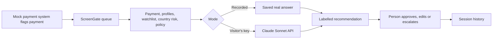
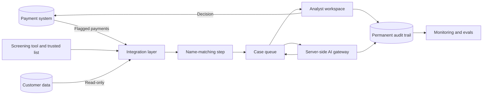

# ScreenGate: Architecture

How the prototype is built today, and how a production version could work. The production design is a proposal. It hasn't been built, and it would change once a company's systems are known.

## Today: the prototype

A single `index.html` file with no backend or build step, hosted on GitHub Pages. Without a key, it replays saved real answers. With a key, it calls the model directly from the browser.

| Layer | Today |
|---|---|
| Interface | Vanilla HTML, CSS and JavaScript in one file |
| Data | Synthetic CSV and policy files, embedded in the page |
| Model | Anthropic Messages API, `claude-sonnet-4-5`, up to 1,024 output tokens |
| Output | Labelled text fields, parsed by the page |
| API key | Saved only in the visitor's browser, never in this repo |
| State | Decisions last for the session only |
| Actions | Simulated. No money moves |

## Proposed: a production version

| Component | Purpose | Key question |
|---|---|---|
| Integration layer | Takes flagged payments and profiles | Which systems and formats apply? |
| Name-matching step | Narrows a large list before the AI sees it | Which existing tool or method does this? |
| AI gateway | Keeps keys on a server, limits data, logs calls and handles failures | Which models and regions are approved? |
| Analyst workspace | The review screen, with real sign-in and roles | Which roles and approvals apply? |
| Audit trail | Records evidence, recommendation, decision and approver | What retention rules apply? |
| Monitoring and evals | Tracks quality and re-runs test cases | Who reviews it, and how often? |

## Why this differs from the prototype

- A real watchlist has far more entries than fit in a prompt, so the prototype's approach wouldn't scale.
- Payment decisions need permanent records.
- Personal data and keys can't depend on a browser-only setup.

## Rollout path

| Stage | Reads | Writes | Purpose |
|---|---|---|---|
| Alongside current process | Flagged payments | Nothing to the payment system | Compare recommendations with analysts' decisions |
| Assisted | Flagged payments | Analyst's decision, after review | Measure time saved and quality |
| Wider use | As agreed | As agreed | Add corridors only with evidence |

## If the AI fails

The analyst's manual process continues. A failed or unparseable answer shows a notice and never becomes an automatic decision.
